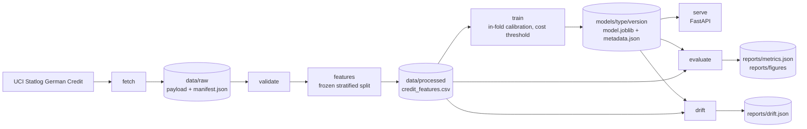

# Classification-Credit-Customer

Credit default scoring on the Statlog German Credit data, with a 5:1 cost-aware decision threshold, in-fold isotonic calibration and per-applicant reason codes served over HTTP.

## What this is

A complete credit-risk pipeline for a 1000-row lending dataset: download with a pinned checksum, a data contract that fails loudly, a frozen stratified split, logistic regression, LightGBM, XGBoost and CatBoost compared under the same protocol, isotonic calibration fitted only on inner folds, and a decision threshold chosen to minimise expected cost instead of maximising accuracy. Artifacts are versioned under `models/<model>/<version>/`, the serving layer loads `latest`, and `/predict` returns a calibrated default probability, an approve or reject decision, its expected cost and the top three feature contributions. Monitoring is a population stability index report against the training distributions. The whole thing runs offline in tests; a full four-candidate train takes about 20 minutes on one CPU because CatBoost fits 30 boosters per validation pass.

## Why it was rebuilt

The original coursework notebook (kept unmodified in `legacy/`) reached 0.911 test accuracy with an SVM after grid search, but it oversampled with SMOTE before the train/test split, fitted the scaler and the one-hot encoder on the full frame, and then scored a balanced 140/140 test set. Synthetic copies of training rows sat inside the test set, the test distribution did not match the 30 percent default rate, and no cost matrix existed. This rebuild fixes the protocol first, then reports what the model is actually worth: out-of-sample predictions only, calibration fitted inside folds, a cost-based threshold, and both a baseline and the main model on the same rows.

## Results

Numbers below come from the run of 2026-10-31 with `configs/tuned.yaml`, written by
`python -m credit_risk train --config configs/tuned.yaml --track` and
`python -m credit_risk evaluate --config configs/tuned.yaml`. The search ran on the
development folds only, so the held-out 200 applications are still scored once, by
the registered artifact, and never used for a choice. Fold spread is the standard
deviation across the five folds.

| Model | Evaluation | ROC-AUC | PR-AUC | KS | Brier | ECE | Accuracy at threshold | Cost per 1000 | Cost at 0.5 per 1000 |
|---|---|---|---|---|---|---|---|---|---|
| Logistic regression (deployed) | 5-fold CV mean | 0.7711 | 0.5657 | 0.4423 | 0.1695 | 0.0806 | 0.619 | 541.2 | n/a |
| LightGBM | 5-fold CV mean | 0.7809 | 0.5762 | 0.4625 | 0.1672 | 0.0811 | 0.625 | 510.0 | n/a |
| XGBoost | 5-fold CV mean | 0.7854 | 0.5748 | 0.4583 | 0.1682 | 0.0706 | 0.596 | 553.8 | n/a |
| CatBoost | 5-fold CV mean | 0.7836 | 0.5677 | 0.4786 | 0.1689 | 0.0916 | 0.611 | 543.8 | n/a |
| Logistic regression (deployed) | Held-out 20 percent | 0.8002 | 0.6090 | 0.5190 | 0.1613 | 0.0700 | 0.605 | 555.0 | 925.0 |
| LightGBM | Held-out 20 percent | 0.7810 | 0.6305 | 0.4500 | 0.1637 | 0.0461 | 0.565 | 595.0 | 870.0 |
| XGBoost | Held-out 20 percent | 0.7970 | 0.6331 | 0.4571 | 0.1600 | 0.0611 | 0.545 | 595.0 | 750.0 |
| CatBoost | Held-out 20 percent | 0.8047 | 0.6690 | 0.4952 | 0.1549 | 0.0695 | 0.630 | 570.0 | 620.0 |

The same 200 held-out applications scored under the main policies:

| Policy | Threshold | Expected cost per 1000 | Approval rate |
|---|---|---|---|
| Always approve | none | 1500.0 | 1.000 |
| Always reject | none | 700.0 | 0.000 |
| CatBoost, default threshold | 0.500 | 620.0 | 0.680 |
| CatBoost, cost-optimal threshold | 0.259 | 570.0 | 0.430 |
| Logistic regression, default threshold | 0.500 | 925.0 | 0.825 |
| Logistic regression, cost-optimal threshold | 0.189 | 555.0 | 0.385 |
| Oracle threshold on holdout labels (not deployable) | 0.242 | 495.0 | 0.505 |

The deployed policy is the logistic regression at 0.1892: 555.0 per 1000, which is
15.0 below CatBoost and 145.0 below rejecting everyone.

What these numbers say:

- **The four candidates are inside noise of each other, and CatBoost has the best
  ranking.** CatBoost leads the held-out ROC-AUC (0.8047), PR-AUC (0.6690) and
  Brier (0.1549); the logistic regression leads on expected cost (555.0 against
  570.0) because its probabilities sit on the right side of the 5:1 break-even more
  often, not because it ranks better. The 15.0 per 1000 gap is 3.0 cost units
  on a 200-row holdout, so it is not an established difference.
- **The threshold, not the model, produces most of the value.** Moving from 0.5 to
  the cost-optimal threshold cuts expected cost from 925.0 to 555.0 per 1000 for the
  deployed model, and from 620.0 to 570.0 for CatBoost. Accuracy on those same rows
  falls at the same time, because the policy rejects 61.5 percent of applicants:
  accuracy is the wrong objective when a bad loan costs five times a good one.
- **Calibration and conformal coverage differ by family.** At a nominal 90 percent,
  the split-conformal band covers 0.915 of holdout rows for logistic and CatBoost,
  0.910 for LightGBM and XGBoost. `reports/train_summary.json` reports a different
  number for the same models (0.93 for logistic) because it is written before the
  scored run and measures coverage on the inner folds; its `slice` field says so. ECE on the holdout is 0.0700 for logistic, 0.0461
  for LightGBM, 0.0611 for XGBoost and 0.0695 for CatBoost; the boosted models are
  better calibrated out of the box than the linear one, which is why isotonic
  calibration was chosen per candidate instead of assumed.
- **Both trivial policies lose** at every tuned threshold. Approving everyone costs
  1500 per 1000; rejecting everyone costs 700; the worst candidate policy here costs
  595.

Champion selection is by held-out expected cost, which is why the logistic
regression is deployed and CatBoost, despite the best AUC, is registered as a
challenger with the `champion` alias on the logistic version. That rule is written
down in `reports/train_summary.json` next to the numbers it produced, so a reader
can disagree with the rule without having to guess it.

## Quickstart

```bash
python -m pip install -e ".[dev]"
python -m credit_risk fetch
python -m credit_risk features
python -m credit_risk train
python -m credit_risk evaluate
dvc repro validate features   # data stages only; training is locked by its MLflow run
```

Then serve the registered artifact:

```bash
python -m credit_risk serve --port 8000
curl -s localhost:8000/health
curl -s localhost:8000/model/info
```

Every command accepts `--config path/to/other.yaml` and `--root path/to/project`. The verbs are `fetch`, `validate`, `features`, `train`, `evaluate`, `drift` and `serve`; `Makefile` wraps the same calls. To check the repository itself:

```bash
python -m pytest -q
ruff check .
```

## Data

Source: [UCI Statlog German Credit](https://archive.ics.uci.edu/dataset/144/statlog+german+credit+data), the 1000-row, 20-attribute version. The fetcher downloads

```text
https://archive.ics.uci.edu/ml/machine-learning-databases/statlog/german/german.data
```

space separated with no header, and falls back to the release archive `https://archive.ics.uci.edu/static/public/144/statlog+german+credit+data.zip` if needed. On the run recorded here the direct file was used and no fallback was needed. The payload is 79,793 bytes with SHA256 `b21f3d81db8071257d5ff1deaeba1fd4303b62712e6fcc9715c7a86202cb5871`, fetched at 2026-10-31T12:00:17+00:00, 1000 rows and 21 columns, 700 good and 300 bad applicants. The attribute description is downloaded alongside it to `data/raw/german_credit.names`.

No copy of the data is committed. `data/` is gitignored, the manifest in `data/raw/manifest.json` pins the checksum and row count, and `fetch` is a no-op when the cached file still matches its manifest (use `--force` to refetch). Licence: public research dataset distributed by UCI, originally collected from 1970s German credit applications; cite the UCI Statlog collection if you reuse it.

## Architecture



The split lives in the processed file as `fold` and `is_heldout` columns, so `train`, `evaluate` and `drift` all see the same rows instead of each recomputing a split. Artifacts are `models/<model_type>/<version>/{model.joblib,metadata.json,reference.json}`, and `models/latest` is a text pointer to the deployed one.

### What is modern in this repository

The first rebuild had the right protocol and home-made tools. The current tree
replaces them with the libraries a credit-risk team actually runs:

| Concern | Library or file | Notes |
| --- | --- | --- |
| Tracking and registry | MLflow 3, SQLite store (`sqlite:///mlflow.db`) | one run per candidate, `credit_risk_<model>` registered, `champion` alias |
| Hyperparameter search | Optuna 5, TPE plus MedianPruner | `reports/optuna.db`, writes `configs/tuned.yaml`; the search scores expected cost, not accuracy |
| Data contract | Pandera 0.35 | column, dtype and range checks before any model sees the frame |
| Calibration | isotonic and Platt chosen per candidate by inner-fold Brier | `models/calibration.py`, Brier and ECE in the metadata |
| Uncertainty | split conformal on inner-fold scores | `models/conformal.py`, coverage reported on the holdout |
| Attribution | SHAP tree values plus exact linear contributions | `models/explain.py`, grouped back to the original attribute |
| Candidates | logistic, LightGBM, XGBoost, CatBoost | native categorical handling for the two boosted libraries |
| Drift report | Evidently 0.7 next to the hand-written PSI | `monitor/evidently_report.py` |
| Data versioning | DVC 3 | `dvc.yaml` and a committed `dvc.lock`: the payload is tracked as a pointer (`data/raw/german.data.dvc`), `dvc repro validate features` rebuilds the data stages |

CI runs the core suite on every push, a `modern` job that installs the tracking,
tuning and report extras but not torch, and a `deep` job kept for
`workflow_dispatch`.

## Model card

Summary: a logistic regression on 21 features (20 raw Statlog attributes plus credit amount per month of term), isotonic calibrated, with a cost-optimal threshold of 0.1905 and top-three coefficient-based contributions per prediction. LightGBM is registered alongside it as the challenger. Intended use is demonstration and portfolio review on this dataset, not real lending decisions. Full details, including fairness caveats and the cost assumptions, are in [`docs/model_card.md`](docs/model_card.md); the attribute and code dictionary is in [`docs/data_dictionary.md`](docs/data_dictionary.md).

For the deployed logistic regression, reason codes are the fitted coefficient multiplied by the encoded value, which is exact and additive for a linear model. For the LightGBM challenger the same endpoint would return `pred_contrib=True` values, which is exact tree SHAP with no extra dependency, and `/model/info` reports which method the loaded artifact uses. In both cases contributions of the one-hot columns that belong to the same attribute are summed, so an attribute appears once, and the three largest are returned with readable names such as `checking account status = A11 (overdrawn account)`. They are contributions to the model's log-odds score, not causal explanations of a customer's creditworthiness. Calibration is a monotone transform of that score, so the sign and order of contributions survive it, but the numbers are log-odds units, not probability points, and for the logistic model the numeric features enter standardised, so a coefficient contribution is per standard deviation of that feature.

## Monitoring

`python -m credit_risk drift` compares a frame with the training distribution stored in the artifact's `reference.json` and writes `reports/drift.json`. It reports population stability index per feature for each numeric feature (quantile bins from the reference) and each categorical feature (categories below one percent of the reference are pooled), with `warn` at 0.10 and `alert` at 0.25.

On the run recorded here the whole processed file scores PSI 0.0041 at worst (`purpose`) and the held-out slice scores 0.0725 at worst (`age_years`), both below the warning line. That is expected: the holdout is a random split of the same 1000 rows, so this exercises the monitor rather than measuring production drift. A real deployment should feed the clicked-through application stream to `--input` and watch the alert count, and retrain when a feature crosses 0.25 or when the observed default rate leaves the training interval.

## Limitations

- **Sample size.** 1000 rows, 200 of them held out. The spread between the best and worst candidate is 43.8 per 1000 in CV and 40.0 on the holdout, both smaller than one fold standard deviation of the CV cost, so the ranking is not established. Treat the CV mean as the headline and the holdout as a sanity check.
- **The notebook's 0.911 accuracy is not comparable.** It was measured on a SMOTE-balanced test set after oversampling the full frame, and the AUC printed there was computed from hard labels. This rebuild reports 0.771 to 0.785 CV ROC-AUC across the four candidates and 0.605 accuracy for the deployed policy on the held-out 200 at the real 30 percent default rate. The accuracy drop is the cost policy working, not a regression; the AUC is the honest measure of ranking.
- **The cost ratio is an assumption.** 5:1 comes from the dataset documentation, not from this business. At a different ratio the optimal threshold moves: the break-even is `cost_good_rejected / (cost_good_rejected + cost_bad_approved)`, 1/6 here.
- **Costs are realised costs on observed labels.** There is no reject inference: the model never sees what would have happened to applicants it rejected, so the estimated saving assumes the historical labels are what the policy would face.
- **No fairness audit.** `personal_status_sex`, `age_years` and `foreign_worker` are inputs, and the data comes from 1970s Germany. The pipeline reports no subgroup metrics and should not be used for decisions about people without one.
- **Calibration is not a free win here.** For the deployed logistic regression it raised the holdout Brier from 0.1531 uncalibrated to 0.1613 calibrated. The run records the uncalibrated Brier only for the deployed candidate, so this README makes no claim about the other three; all four selected isotonic, and the calibrator is fitted on inner folds of an 800-row training set, which is small for isotonic regression.
- **One threshold for everyone.** The cost-optimal threshold is a single scalar; segment-specific thresholds and capacity constraints (for example a fixed approval budget) are not modelled.
- **The search is small and partly inherited.** The Optuna studies are resumed by name, so the logistic and LightGBM studies hold 33 trials each: 23 from an earlier invocation and 10 from the one that wrote `configs/tuned.yaml`. Both best values come from that earlier invocation (trial 14 and trial 15), which the header of `configs/tuned.yaml` records. CatBoost kept its configured parameters because its study stalled with two trials still `RUNNING`. A 1000-row dataset does not support a large search: more trials mostly fit fold noise.
- **Reason codes are not explanations in the regulatory sense.** They are additive contributions to a model score, and correlated features share credit arbitrarily.

## Project layout

```text
.
|-- configs/base.yaml              run settings, seed, cost matrix, model params
|-- data/                          gitignored: raw payload, manifest, processed file
|-- docs/
|   |-- model_card.md
|   `-- data_dictionary.md
|-- legacy/                        original coursework, unmodified
|   |-- CustomerCreditClassification.ipynb
|   `-- German Credit.txt
|-- models/                        gitignored: versioned artifacts and latest pointer
|-- reports/                       gitignored: metrics.json, drift.json, figures
|-- src/credit_risk/
|   |-- cli.py                     fetch, validate, features, train, evaluate, drift, serve
|   |-- config.py                  typed config tree loaded from YAML
|   |-- data/                      schema, fetch, validate
|   |-- features/build.py          derived features, frozen split
|   |-- models/                    bundle, metrics, train, evaluate, registry
|   |-- monitor/drift.py           PSI against the training reference
|   `-- serving/app.py             FastAPI endpoints
|-- tests/                         offline suite on synthetic fixtures
|-- Dockerfile
|-- Makefile
`-- pyproject.toml
```

## License

MIT, copyright Hoang Hieu Nguyen. See `LICENSE`.
