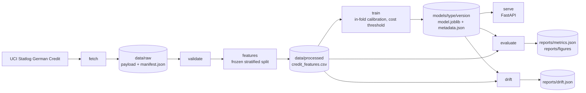

# Classification-Credit-Customer

Credit default scoring on the Statlog German Credit data, with a 5:1 cost-aware decision threshold, in-fold isotonic calibration and per-applicant reason codes served over HTTP.

## What this is

A complete credit-risk pipeline for a 1000-row lending dataset: download with a pinned checksum, a data contract that fails loudly, a frozen stratified split, logistic regression and LightGBM compared under the same protocol, isotonic calibration fitted only on inner folds, and a decision threshold chosen to minimise expected cost instead of maximising accuracy. Artifacts are versioned under `models/<model>/<version>/`, the serving layer loads `latest`, and `/predict` returns a calibrated default probability, an approve or reject decision, its expected cost and the top three feature contributions. Monitoring is a population stability index report against the training distributions. The whole thing runs offline in tests and in about 20 seconds on this dataset.

## Why it was rebuilt

The original coursework notebook (kept unmodified in `legacy/`) reached 0.911 test accuracy with an SVM after grid search, but it oversampled with SMOTE before the train/test split, fitted the scaler and the one-hot encoder on the full frame, and then scored a balanced 140/140 test set. Synthetic copies of training rows sat inside the test set, the test distribution did not match the 30 percent default rate, and no cost matrix existed. This rebuild fixes the protocol first, then reports what the model is actually worth: out-of-sample predictions only, calibration fitted inside folds, a cost-based threshold, and both a baseline and the main model on the same rows.

## Results

Headline numbers use stratified 5-fold cross-validation on the 800-row development partition. The held-out 20 percent (200 rows) is scored once by the registered artifact and never used for any choice. Values are measured by `python -m credit_risk evaluate` and stored in `reports/metrics.json`; fold spread is the standard deviation across the five folds.

| Model | Evaluation | ROC-AUC | PR-AUC | KS | Brier | Accuracy at threshold | Cost per 1000 | Cost at 0.5 per 1000 |
|---|---|---|---|---|---|---|---|---|
| Logistic regression (baseline) | 5-fold CV mean | 0.764 | 0.559 | 0.429 | 0.172 | 0.568 | 537.5 | 1123.8 |
| LightGBM | 5-fold CV mean | 0.786 | 0.582 | 0.468 | 0.166 | 0.591 | 553.8 | 1003.8 |
| Logistic regression (baseline) | Held-out 20 percent | 0.801 | 0.615 | 0.536 | 0.162 | 0.645 | 515.0 | 840.0 |
| LightGBM | Held-out 20 percent | 0.768 | 0.625 | 0.440 | 0.169 | 0.520 | 640.0 | 725.0 |

Fold spread for the CV rows: LightGBM ROC-AUC 0.786 +/- 0.046 and cost 553.8 +/- 100.4; logistic ROC-AUC 0.764 +/- 0.061 and cost 537.5 +/- 58.8. The chosen thresholds are 0.200 for LightGBM and 0.190 for the baseline, against an analytic break-even of 1/6 = 0.167 for a 5:1 cost ratio.

The same 200 held-out applications scored under the main policies:

| Policy | Threshold | Expected cost per 1000 | Approval rate |
|---|---|---|---|
| Always approve | none | 1500.0 | 1.000 |
| Always reject | none | 700.0 | 0.000 |
| LightGBM, default threshold | 0.500 | 725.0 | 0.725 |
| LightGBM, cost-optimal threshold | 0.200 | 640.0 | 0.300 |
| Logistic regression, default threshold | 0.500 | 840.0 | 0.790 |
| Logistic regression, cost-optimal threshold | 0.190 | 515.0 | 0.425 |
| Logistic regression, oracle threshold on holdout labels (not deployable) | 0.335 | 485.0 | 0.575 |

The deployed policy is the logistic regression at 0.190: 515.0 per 1000, which is 125.0 below the LightGBM policy and 185.0 below rejecting everyone.

Confusion matrices at each candidate's own threshold, on the 200 held-out applications, deployed model first:

| | logistic: approve | logistic: reject | LightGBM: approve | LightGBM: reject |
|---|---|---|---|---|
| actual: good | 77 | 63 | 52 | 88 |
| actual: bad | 8 | 52 | 8 | 52 |

Both candidates approve the same 8 of the 60 bad applicants. The difference is on good applicants: LightGBM rejects 25 more of them, and 25 extra rejections per 200 applications is the 125.0 per 1000 gap.

What these numbers say:

- **LightGBM does not beat the logistic regression on this dataset, which is why the logistic model is deployed.** Cross-validation puts LightGBM slightly ahead on ranking (ROC-AUC 0.786 versus 0.764, PR-AUC 0.582 versus 0.559) and slightly behind on cost (553.8 versus 537.5). On the 200-row holdout the logistic model wins on both AUC (0.801 versus 0.768) and cost (515.0 versus 640.0). All of these gaps are inside one fold standard deviation. With 1000 rows the two models are within noise of each other, so the choice is made on the one protocol in the brief that maps to money: held-out expected cost.
- **The threshold, not the model, produces most of the value.** Moving from 0.5 to the cost-optimal threshold cuts expected cost from 725.0 to 640.0 per 1000 for LightGBM, and from 840.0 to 515.0 for the baseline. Accuracy on the same held-out rows falls at the same time, from 0.775 at 0.5 to 0.520 at 0.200 for LightGBM, and from 0.780 to 0.645 for the deployed model, because that policy rejects 58 percent of applicants (LightGBM's rejects 70 percent): accuracy is the wrong objective when a bad approval costs five times a good rejection.
- **Isotonic calibration did not improve the Brier score on the holdout, for either candidate.** For the deployed logistic regression it is 0.1543 uncalibrated and 0.1623 calibrated; for LightGBM it is 0.1673 and 0.1685. Both raw models were already close to calibrated at this sample size, and fitting a monotone map on 800 inner-fold rows adds variance. The calibrator is kept because the same protocol is applied to every candidate and because the cost threshold is defined on the calibrated scale, but the honest statement is that it is not an accuracy gain here.
- **Both models beat both trivial policies** at their thresholds. Rejecting everyone costs 700 per 1000; approving everyone costs 1500.

The deployed artifact is the logistic regression at threshold 0.1905, because it has the lower held-out expected cost of the two candidates (515.0 against 640.0 per 1000) and the better held-out ROC-AUC. LightGBM remains registered as the challenger: it ranks slightly better in cross-validation (0.786 against 0.764) and `pred_contrib=True` gives exact tree SHAP contributions, but it costs 125.0 more per 1000 on the held-out rows. Both candidates go through the same threshold rule, a single cost-minimising cut on calibrated probabilities, so choosing between them does not change the decision logic; `train.deployed_model` in `configs/base.yaml` only decides which artifact `models/latest` points at, and the API serves whichever one it finds there.

## Quickstart

```bash
python -m pip install -e ".[dev]"
python -m credit_risk fetch
python -m credit_risk features
python -m credit_risk train
python -m credit_risk evaluate
```

Then serve the registered artifact:

```bash
python -m credit_risk serve --port 8000
curl -s localhost:8000/health
curl -s localhost:8000/model/info
```

Every command accepts `--config path/to/other.yaml` and `--root path/to/project`. The verbs are `fetch`, `validate`, `features`, `train`, `evaluate`, `drift` and `serve`; `Makefile` wraps the same calls. To check the repository itself:

```bash
python -m pytest -q
ruff check .
```

## Data

Source: [UCI Statlog German Credit](https://archive.ics.uci.edu/dataset/144/statlog+german+credit+data), the 1000-row, 20-attribute version. The fetcher downloads

```text
https://archive.ics.uci.edu/ml/machine-learning-databases/statlog/german/german.data
```

space separated with no header, and falls back to the release archive `https://archive.ics.uci.edu/static/public/144/statlog+german+credit+data.zip` if needed. On the run recorded here the direct file was used and no fallback was needed. The payload is 79,793 bytes with SHA256 `b21f3d81db8071257d5ff1deaeba1fd4303b62712e6fcc9715c7a86202cb5871`, fetched at 2026-10-31T12:00:17+00:00, 1000 rows and 21 columns, 700 good and 300 bad applicants. The attribute description is downloaded alongside it to `data/raw/german_credit.names`.

No copy of the data is committed. `data/` is gitignored, the manifest in `data/raw/manifest.json` pins the checksum and row count, and `fetch` is a no-op when the cached file still matches its manifest (use `--force` to refetch). Licence: public research dataset distributed by UCI, originally collected from 1970s German credit applications; cite the UCI Statlog collection if you reuse it.

## Architecture



The split lives in the processed file as `fold` and `is_heldout` columns, so `train`, `evaluate` and `drift` all see the same rows instead of each recomputing a split. Artifacts are `models/<model_type>/<version>/{model.joblib,metadata.json,reference.json}`, and `models/latest` is a text pointer to the deployed one.

## Model card

Summary: a logistic regression on 21 features (20 raw Statlog attributes plus credit amount per month of term), isotonic calibrated, with a cost-optimal threshold of 0.1905 and top-three coefficient-based contributions per prediction. LightGBM is registered alongside it as the challenger. Intended use is demonstration and portfolio review on this dataset, not real lending decisions. Full details, including fairness caveats and the cost assumptions, are in [`docs/model_card.md`](docs/model_card.md); the attribute and code dictionary is in [`docs/data_dictionary.md`](docs/data_dictionary.md).

For the deployed logistic regression, reason codes are the fitted coefficient multiplied by the encoded value, which is exact and additive for a linear model. For the LightGBM challenger the same endpoint would return `pred_contrib=True` values, which is exact tree SHAP with no extra dependency, and `/model/info` reports which method the loaded artifact uses. In both cases contributions of the one-hot columns that belong to the same attribute are summed, so an attribute appears once, and the three largest are returned with readable names such as `checking account status = A11 (overdrawn account)`. They are contributions to the model's log-odds score, not causal explanations of a customer's creditworthiness. Calibration is a monotone transform of that score, so the sign and order of contributions survive it, but the numbers are log-odds units, not probability points, and for the logistic model the numeric features enter standardised, so a coefficient contribution is per standard deviation of that feature.

## Monitoring

`python -m credit_risk drift` compares a frame with the training distribution stored in the artifact's `reference.json` and writes `reports/drift.json`. It reports population stability index per feature for each numeric feature (quantile bins from the reference) and each categorical feature (categories below one percent of the reference are pooled), with `warn` at 0.10 and `alert` at 0.25.

On the run recorded here the whole processed file scores PSI 0.0041 at worst (`purpose`) and the held-out slice scores 0.0725 at worst (`age_years`), both below the warning line. That is expected: the holdout is a random split of the same 1000 rows, so this exercises the monitor rather than measuring production drift. A real deployment should feed the clicked-through application stream to `--input` and watch the alert count, and retrain when a feature crosses 0.25 or when the observed default rate leaves the training interval.

## Limitations

- **Sample size.** 1000 rows, 200 of them held out. The difference between the two models is smaller than one fold standard deviation, so the ranking between them is not established. Treat the CV mean as the headline and the holdout as a sanity check.
- **The notebook's 0.911 accuracy is not comparable.** It was measured on a SMOTE-balanced test set after oversampling the full frame, and the AUC printed there was computed from hard labels. This rebuild reports 0.764 to 0.786 CV ROC-AUC across the two candidates and 0.645 accuracy for the deployed policy at the real 30 percent default rate. The accuracy drop is the cost policy working, not a regression; the AUC is the honest measure of ranking.
- **The cost ratio is an assumption.** 5:1 comes from the dataset documentation, not from this business. At a different ratio the optimal threshold moves: the break-even is `cost_good_rejected / (cost_good_rejected + cost_bad_approved)`, 1/6 here.
- **Costs are realised costs on observed labels.** There is no reject inference: the model never sees what would have happened to applicants it rejected, so the estimated saving assumes the historical labels are what the policy would face.
- **No fairness audit.** `personal_status_sex`, `age_years` and `foreign_worker` are inputs, and the data comes from 1970s Germany. The pipeline reports no subgroup metrics and should not be used for decisions about people without one.
- **Calibration is not a free win here.** As reported above, the Brier score did not improve on the holdout for either candidate: 0.1543 to 0.1623 for the deployed logistic regression, 0.1673 to 0.1685 for LightGBM. The calibrator is fitted on inner folds of an 800-row training set, which is small for isotonic regression.
- **One threshold for everyone.** The cost-optimal threshold is a single scalar; segment-specific thresholds and capacity constraints (for example a fixed approval budget) are not modelled.
- **No hyperparameter search.** Both models use fixed, modest settings; tuning on this holdout would have invalidated it, and nested tuning was out of scope.
- **Reason codes are not explanations in the regulatory sense.** They are additive contributions to a model score, and correlated features share credit arbitrarily.

## Project layout

```text
.
|-- configs/base.yaml              run settings, seed, cost matrix, model params
|-- data/                          gitignored: raw payload, manifest, processed file
|-- docs/
|   |-- model_card.md
|   `-- data_dictionary.md
|-- legacy/                        original coursework, unmodified
|   |-- CustomerCreditClassification.ipynb
|   `-- German Credit.txt
|-- models/                        gitignored: versioned artifacts and latest pointer
|-- reports/                       gitignored: metrics.json, drift.json, figures
|-- src/credit_risk/
|   |-- cli.py                     fetch, validate, features, train, evaluate, drift, serve
|   |-- config.py                  typed config tree loaded from YAML
|   |-- data/                      schema, fetch, validate
|   |-- features/build.py          derived features, frozen split
|   |-- models/                    bundle, metrics, train, evaluate, registry
|   |-- monitor/drift.py           PSI against the training reference
|   `-- serving/app.py             FastAPI endpoints
|-- tests/                         offline suite on synthetic fixtures
|-- Dockerfile
|-- Makefile
`-- pyproject.toml
```

## License

MIT, copyright Hoang Hieu Nguyen. See `LICENSE`.
